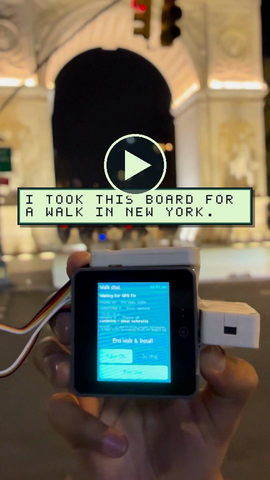
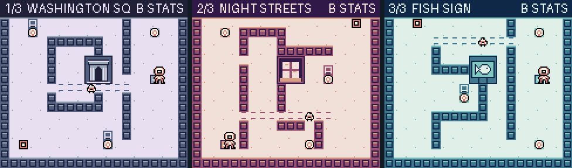

# Corner Walk

**A walk that becomes a Game Boy game.**

Carry an M5Stack CoreS3 on a walk. It logs your route by GPS and talks with you
about what its camera sees. Tap **End Walk & Install** and a Mac turns the walk
into a Game Boy Color game and writes it to the cartridge in a ModRetro
Chromatic.

Built in one afternoon at OpenAI's hardware hackathon in New York on
November 19, 2026.

<p align="center">
  <a href="https://x.com/sriramkiron/status/2123829426177912918"></a>
  <br>
  <a href="https://x.com/sriramkiron/status/2123829426177912918">Watch the recap on X</a>
</p>

## The first walk

That evening the board went from the Washington Square Arch up Fifth Avenue.
Its two journals, 487 GPS fixes and the conversation along the way, became
*Square After Dark*:



The radio dialogue in the game is what the board said on the walk. At the arch
it could not place the landmark in the dark until it was told the name of the
park. In level 1 that became "Since you're at Washington Square Park, the arch
you showed is the Washington Square Arch." Level 3 is named for a sign it did
manage to read: "I can clearly see the word 'Ceviche' next to a fish
illustration."

To play it, open
[`square-after-dark.gbc`](game/artifacts/washington-square-after-dark/square-after-dark.gbc)
in a Game Boy Color emulator. Use the D-pad to move, **A** on a marker to read
it and **B** to see your stamp count. Collect every stamp to open the gate. The
dashed lane is a shortcut patrolled by a drone.

## How it works

```
StickS3 + distance sensor ──ESP-NOW──▶ CoreS3 ──iPhone hotspot──▶ HTTPS tunnel ──▶ Mac
                                                                                    │
                                              relay/live.py            starts voice sessions
                                              relay/walk_receiver.py   builds and installs the game
```

1. **Log.** The CoreS3 reads a GPS unit and appends every fix to a journal on
   its own flash, so the walk keeps recording when the hotspot drops.
2. **Talk.** Tap **Talk** and the board opens a WebRTC voice session with
   `gpt-live-1.1`. When you ask about what it is looking at, the session hands
   the question to `gpt-6-luna`, which takes one 320 × 240 photo with the
   board's camera. Captions go into the journal. Photos are not kept.
3. **Trigger.** Optionally, a StickS3 with a time-of-flight sensor starts a
   chat on its own. Hold an object 10–55 cm in front of it and the CoreS3 takes
   a photo and opens with a question about it. The two boards talk over
   encrypted ESP-NOW.
4. **Build.** **End Walk & Install** uploads the journal to the Mac.
   `tools/make_walk_game.py` turns the route into up to three levels and puts
   chats and camera observations on the tiles where they happened, when a GPS
   fix was recorded within three seconds of them.
   `gpt-6.2-sol` writes the title and the welcome and finish lines, and GB
   Studio's CLI compiles the ROM.
5. **Install.** `relay/install_chromatic.mjs` writes the ROM to the Chromatic's
   cartridge through the
   [ModRetro Chromatic plugin for Codex](https://github.com/OpenAI-Partners/ModRetro-Chromatic-Plugin-for-Codex).
   The CoreS3 shows the build and install status.

The OpenAI API key stays on the Mac. The board only holds a device token for
the relay.

## Hardware

- M5Stack CoreS3 on a DinBase, with the GPS/BDS Unit v1.1 on Port C
- M5Stack StickS3 with a ToF HAT (VL53L0X), for the optional distance trigger
- ModRetro Chromatic with a rewritable cartridge
- A Mac and an iPhone hotspot. The setup tools are written for macOS.

## What's in the repo

| Path | Contents |
| --- | --- |
| `firmware/cores3/walk_logger/` | The CoreS3 app: GPS journal, screen and USB commands |
| `firmware/cores3/live/` | ESP-IDF build of the same app with voice, camera, the distance trigger and upload. [Its README](firmware/cores3/live/README.md) is the full setup guide. |
| `firmware/cores3/gps_check/` | Small GPS wiring test |
| `firmware/sticks3/` | Distance trigger for the StickS3 |
| `firmware/shared/` | Pairing and packet code used by both boards |
| `relay/` | Mac side: voice session server, walk receiver, game text and cartridge install |
| `tools/` | USB setup for the hotspot, relay address and pairing; journal export; the game and level generator; tests |
| `game/` | The GB Studio project each walk is rendered into. [`game/README.md`](game/README.md) explains the game rules. |
| `game/artifacts/` | Example games with their ROMs: the Washington Square walk and three built from simulated walks |
| `walks/` | The two journals from the Washington Square walk |
| `PLAN.md` | The plan written before the event. The build diverged from it in places: the companion became a live voice session and the StickS3 became a distance trigger. |

## Try it without the hardware

The generator needs Python 3 and Pillow.

```sh
pip install pillow
python3 -m unittest tools.test_walk_memories

cp -R game /tmp/corner-walk-game
python3 tools/make_walk_game.py walks/walk-2026-11-20T012334Z-20686.jsonl \
  --project /tmp/corner-walk-game
```

That rewrites the copied project with levels for the walk. Open
`/tmp/corner-walk-game/project.gbsproj` in GB Studio 4.2, or compile it with GB
Studio's CLI:

```sh
node "$GB_STUDIO_CLI" make:rom /tmp/corner-walk-game/project.gbsproj corner-walk.gbc
```

For the boards, the relay and the cartridge install, follow
[`firmware/cores3/live/README.md`](firmware/cores3/live/README.md).

## About the walk data

The two files in `walks/` are real: a GPS trace through public streets and the
conversation between the walker and the board. A journal can also pick up your
location at home or the voices of people nearby, so `.gitignore` keeps every
other export out of the repo by default.

## License

MIT, see [`LICENSE`](LICENSE). The starter game artwork, the GB Studio project
format and the runtimes inside the compiled ROMs keep their own notices, listed
in [`THIRD_PARTY_NOTICES.md`](THIRD_PARTY_NOTICES.md).
